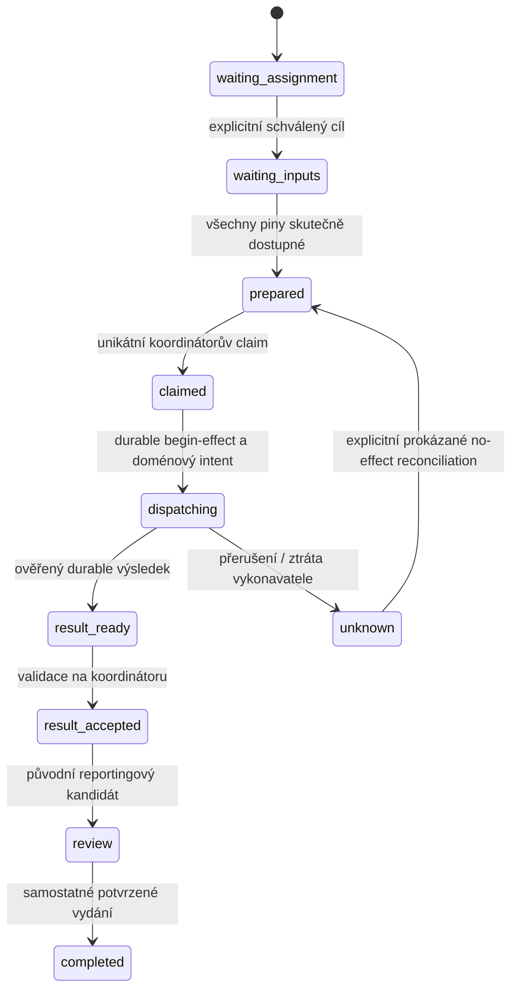

<!-- SPDX-FileCopyrightText: 2026 Antonín Mička -->
<!-- SPDX-License-Identifier: MPL-2.0 -->

# ADR 0080 — přiřazení vykonavatele a autorita monitorovacího běhu

Datum: 2026-11-07. Stav: **navrženo k review / designed**.
Runtime, vzdálené dispatch API ani fyzický PoC tímto dokumentem nevznikají.
MON-08-07 má nejprve designed a následně PoC validated na Omnii a desktopu;
tento výstup uzavírá první úroveň, nikoli celou akceptaci úkolu.

Upřesnění uživatele 7. 11. 2026: vzdálený dispatch se odkládá. Nejprve vzniká
[UI pro oddělené zadání těžby a zpracování](../independent-monitoring.md#ui-těžba-a-zpracování-na-samostatných-uzlech-mon-08-09).
Každá fáze je vlastní propojené WatchDefinition s nezávislým placement;
zpracování přijímá uložené vybrané nálezy a má explicitní manual/scheduled
požadavek. Synchronizace výsledků po prvotní filtraci zůstává cílem MON-08-08,
nikoli účinkem uložení zadání. UI samotné nevydává grant, nepotvrzuje
dostupnost uzlu a neobchází níže uvedené execution a recovery podmínky.

## Ověřený výchozí stav

- WatchDefinition již obsahuje placement local/node/capability, ale RSS a
  příprava nezávislé syntézy přijímají pouze local. Remote metadata tedy dnes
  neznamenají funkční vzdálený běh.
- ReportingScheduler má node-local autoritu rezervace, lease, review a vydání;
  expirace collecting znamená unknown. RSS má vlastní effect state ve stejné
  DB; provider dispatch vlastní původní backend journal.
- Interní obousměrný Git sync již implementuje [ADR 0042](0042-bidirectional-native-git-sharing-sync.md).
  Existuje i starší primary/read-only grant z [ADR 0038](0038-personal-project-replication.md).
  Návrh nesmí přepsat obousměrný sync na globální primary-only datový model.
- Peer trust, účty, mapping, projektové RBAC, sharing scope a credentials jsou
  oddělené. DeploymentTargets je pouze místní preference; není důkaz identity,
  aktivního mapování, dostupnosti ani oprávnění vykonávat práci.

## Návrh rozhodnutí

Pro monitorovací stream projektu bude jeden **explicitně sjednaný koordinátor**
a pro každý effect stream/run právě jeden připnutý vykonavatel. Koordinátor
je autorita monitorovacího intentu a jeho provozního journalu. To není nová
globální role vlastníka projektu ani zákaz ostatních projektových zápisů.
Smlouva potřebuje samostatné execution oprávnění nad schváleným peer/account
mappingem. Synchronizace projektu nebo grant read/replicate není execute grant.

Omnia může být vykonavatel RSS/regex, desktop vykonavatel modelové syntézy;
oba používají stejný kontrakt. Koordinátor může být některý z těchto uzlů.
Jeho nedostupnost pozastaví nové dispatch účinky. Nevzniká volba vedoucího
podle timeoutu, nejnižší UUID ani dostupného RAM. To vědomě upřednostňuje
jednoznačnost před dostupností při partition; návrh není distribuovaný consensus.
Pro referenční PoC je vhodný trvale dostupný koordinátor na Omnii, pokud má
výslovné místní write oprávnění testovacího projektu. Offline desktop pak
pozastaví jeho LLM práci, nikoli místní RSS na Omnii. Pokud je Omnia pouze
read-only replica, tato podmínka neplatí: nepovýší se automaticky na writer.
Při koordinátoru na desktopu je nutné přiznat, že jeho výpadek zastaví i nové
vzdálené dispatch operace. Volba role je součást předchozího review konfigurace.

### Tři nezávislé vrstvy

| Vrstva | Autorita a obsah | Co nedává |
| --- | --- | --- |
| Desired placement | Projektový WatchDefinition pin: mode, veřejné node ID nebo capability požadavky | Aktivaci, credentials ani oprávnění k modelu |
| Execution agreement | Oboustranně potvrzený node-local administrativní záznam: projekt/ref, koordinátor, mapované účty/peery, scope efektů, epoch a revize | Projektovou write roli, automatické vydání ani přenos local-only |
| Run assignment | Koordinátorův durable journal: přesný intent, vykonavatel, agreement/capability revize, fence, stav a receipts | Právo ignorovat unknown nebo přidat nový model/metodu |

Node ID v projektu je veřejný identifikátor požadovaného cíle. Platnost se
ověřuje přes místní schválené mapování na skutečný peer, fingerprint a identity
revision; nesmí se nahradit IP adresou nebo názvem z deployment preference.
Credentials, klíče, session, endpoint lookup a provozní lease zůstávají mimo
projektový Git. Synced výsledek může uvést veřejného vykonavatele a schválenou
assignment revizi, nikdy soukromý lease token nebo provider credential.

### Execution agreement — samostatný autorizační typ

Návrh typu `fpw-monitoring-execution-agreement-v1` obsahuje agreement UUID,
project UUID/ref, coordinator node ID, participant account/node IDs, identity
revision a veřejné fingerprinty, watch scope, povolené efekty, privacy scope,
epoch a číslo revize. Jeho digest se potvrzuje na každém účastnícím se uzlu.
Aktivace vyžaduje místní admin souhlas a platný mapping/trust na obou stranách.
Neznámá či jednostranná dohoda není aktivní.

Použijí se existující Ed25519 identity/signature primitives a CAS/flock writer
Administration. Podpis musí mít vlastní domain separator, nemůže předstírat
existující mapping nebo replication spec. Budoucí rozšíření administrativního
schématu vyžaduje explicitní migraci; nynější validator tento typ neimplementuje.

Lokální registry odmítnou překrývající se aktivní monitoring koordinátory pro
tentýž project/ref/watch stream. Nový koordinátor potřebuje uzavření původní
dohody, vyřešení rozpracovaných intentů a potvrzení všech dotčených účastníků.
Offline koordinátor není důvod tuto podmínku obejít.

## Výběr uzlu, aktivace a preflight

- local znamená tento konkrétní uzel až po node-local aktivaci; import stejné
  definice na druhém uzlu jej neaktivuje. V řízené federaci je nutné také
  přiřazení od sjednaného koordinátora, nikoli jen lokální watch_grant.
- node vyžaduje shodu s přesným schváleným veřejným node ID/pinem. Nedostupnost
  cíle nezmění přiřazení na dostupný jiný stroj.
- capability vybere cíl jen při explicitním schválení assignmentu. Nabídka
  schopností není grant. Při více kandidátech se výběr předloží k review;
  žádné dynamické přepínání modelu či uzlu při každém ticku.
- Offer má revision/hash, pozorovaný čas a platnost; po expiraci je unknown,
  nikoli dostupný. Worker před účinkem ověří skutečnou lokální schopnost znovu.
  Koordinátor ukládá také čas přijetí a ověřený limit clock skew; vzdálený
  timestamp sám neprodlužuje platnost. Neznámé hodiny znamenají blokující
  preflight, ne automatický výběr jiného node. Timeout není důkaz no-effect.
- Preflight zahrnuje connector/schema verzi, síťové oprávnění a podmínky
  zdroje, paměťový/CPU/payload limit, dostupnost modelu a přesný Target,
  privacy boundary, současné ACL a úplnost skutečných vstupních bajtů.
  Samotná capability `llm` neautorizuje binding ani jiný provider.
- Vybraný node musí mít všechny piny v jejich přesných bajtech a povoleném
  scope. Jinak waiting-inputs; hash manifestu není důkaz přenosu jeho obsahu.

Přechod existujícího lokálního grantu do sdíleného režimu vyžaduje inventory
starých bindings/runů a prokazatelné zastavení nového autonomního dispatchu
na všech dotčených instancích. In-flight účinky se nezahodí: dokončí se nebo
zůstanou unknown podle původních journalů. Nepodporovaný/starý worker není
fenced jen tím, že nový proces podepsal dohodu. Aktivace proto vyžaduje také
ověřenou protocol verzi a quiescence starého režimu; neznámý stav blokuje
dotčený stream. Nově federovaný scope s legacy grantem se zobrazí jako
activation-review-required, ne jako nová automaticky aktivní kopie.

Navržené schopnosti jsou verzované identifikátory, např. connector:rss-atom-v1,
filter:regex-isolated-v1, model:generate-text-json-v1. Číselné resource limity
patří do nabídky a vyžadovaného profilu, nikoli do neinterpretovaných názvů.
Regex RLIMIT_AS z MON-08-04 je limit adresního prostoru; nesmí se vydávat za
změřenou spotřebu RAM. Samotný capability manifest neprokazuje výkon Omnie.

## Intent, rezervace a fencing

Logical effect key je stabilní pro project + watch + stream/input + kanonický
slot/periodu + druh účinku; nezahrnuje executor, attempt ani epoch. Proto jiný
uzel nebo nová dohoda neudělají z unknown nový efekt. Definice/rules revize jsou
součástí zmrazeného intentu, nikoli cesta k obejití obsazeného stejného slotu.
Digest logical key se nesmí zaměnit s intent_sha256: ten navíc váže přesnou
definici/rules, vstupní manifest/piny, cutoff, source/model Target a limity.

Koordinátor rozšíří původní ReportingScheduler journal o assignment/effect
záznamy; nevytváří druhou autoritu v projektovém SQLite indexu. Unikátní klíč,
BEGIN IMMEDIATE a monotónní fence zajistí lokálně jediné převzetí. Executor
dostane podepsaný ticket s run/effect ID, intent hashem, konkrétním cílem,
agreement/assignment/capability revizí, vstupy/cutoffem a omezeným scope.
Ticket se nesynchronizuje jako projektový artefakt. Token sám není dlouhodobé
oprávnění a nesmí být přijat na jiném uzlu.

Před externím účinkem musí worker trvale uložit ticket a původní doménový
intent; koordinátor trvale potvrdí begin-effect. Až poté lze jednou vstoupit
do existujícího RSS/backend dispatch journalu. Nestačí offline ověřit podpis
starého ticketu. Ztracená begin odpověď se dohledá pod stejným operation ID;
nepřipraví se nový ticket pro jiný worker. Privátní provider kontext z MON-08-06
se nepřenese jen kvůli výběru uzlu.

Po claimed bez prokázaného begin-effect lze práci explicitně uvolnit pouze
podle obou journalů a receiptů. Po dispatching lease timeout znamená unknown.
Coordinator ani worker nemají právo z timeoutu odvodit, že provider nic neudělal.
Review a completed zde neudělují žádné nové oprávnění k publikaci.

## Výsledek a jediný publikační tok monitoringu

Executor persistuje výsledek původním doménovým journalem a podepíše descriptor:
effect/run ID, intent hash, executor/assignment/fence, input manifest/hash,
payload hash/velikost, backend/RSS receipts, stav a omezení reprodukovatelnosti.
Payload předává samostatný povolený transport. Odpověď musí odpovídat přesnému
ticketu; opožděný jiný fence se nestane výsledkem aktuálního assignmentu.
Starý receipt se uchová pro audit/reconciliation, nesmí se tiše zahodit.
Pozdní výsledek původního nevyřešeného effectu se může ověřit jako jeho
reconciliation; expirace ticketu nebo nová assignment revize z něj nesmí
udělat výsledek jiného běhu. Historický podpis může doložit původ receipt,
ale neobnoví revokované execute/import oprávnění odesílatele.

Koordinátor ověří podpis, actor/project scope, privacy/licenci/retenci, piny,
hash a stav původního effectu. Import SourceFinding nebo reporting kandidáta
použije původní Reporting/Workspace writer a stabilní operation ID. Žádný
remote callback nemůže přímo nastavovat last_success nebo vydávat report.
Read-only replica může být schválený výpočetní vykonavatel se stagingem mimo
projektový Git; vlastní import na ní nemá obcházet _writable(). V same-team
zůstává běžný projektový sync obousměrný; monitoring publication má nadále
svůj jednoznačný provozní intent. Divergence se řeší původním ADR 0043.

Oddělení převzatého resultu od vydaného reportu zůstává stejné jako MON-08-03–06.
Definice/přijaté artefakty se mohou synchronizovat přes původní Git transport;
samotný přenos a dostupnost vstupů rozpracuje MON-08-08. Node-local journaly,
credentials a dispatch lease nejsou synchronizační payload projektu.

## Crash boundaries a obnova

| Hranice | Očekávaná obnova |
| --- | --- |
| Mezi potvrzeními dohody | Jednostranné pending; žádný dispatch. Původní administrativní CAS a signatures. |
| Po rezervaci, před ticket receipt | Dotaz/replay stejného ID; jedno přiřazení, žádný nový executor. |
| Po worker staging, před begin-effect | Kontrola obou journalů; případné explicitní prokázané no-effect. |
| Po begin/dispatch, před výsledkem | Unknown, blokace nového účinku/streamu; doménová reconciliation. |
| Po provider success, před descriptor přijetím | Stejný provider receipt/result; žádné druhé LLM volání. |
| Po accepted-result, před Workspace prepare/ref | Stabilní import ID a původní journal. Result zatím není vydaný artefakt. |
| Po Git ref, před result acknowledgement/indexem | Původní Workspace receipt; index rebuild z HEAD. |
| Ztráta koordinační DB/identity | Restore původní autority + explicitní reconciliation; nevytvořit prázdnou náhradu. |

Převzetí jiným uzlem vyžaduje prokázaný konečný stav starého účinku, zneplatnění
starého oprávnění/fence a nový schválený assignment nad stejným logical key.
Unknown zůstává blokující i po změně executor node nebo coordinator epoch;
u RSS blokuje odpovídající navazující stream podle stávajícího recovery.
U nedostupného původního vykonavatele bez receipt/no-effect důkazu není
bezpečné pokračování. Uživateli se nabídne dohledání původního výsledku,
nikoli tlačítko „zkusit jinde“.

Návrh předpokládá spolupracující implementace a neklonované node credentials.
Nevydává se za ochranu proti dvěma současně běžícím kopiím stejné identity
a obnově starého journal snapshotu vedle živého uzlu. Takový restore vyžaduje
operátorské oplocení původní instance; bez něj nelze slíbit exactly-once efekt.

## Stav pro UI a acceptance

Read model oddělí desired target, skutečný executor, coordinator, assignment
revizi/fence a observed_at. Důvody: unassigned, approval-pending, unknown-peer,
node-unavailable, capability-stale/missing, privacy-denied, waiting-inputs,
ready, running, unknown-effect, result-awaiting-import, review, completed.
Ready nabídka schopností není provedený běh; stale je viditelné a nesmí být
zelený úspěch. Offline desktop čeká, Omnia jej automaticky nenahradí.

## Reuse a stav předání

Reuse/adapt: Administration trust/mapping/CAS a signature primitives,
ReportingScheduler reservations/lease, RSS a provider effect journals,
ContextBuilder/privacy, Workspace receipts a Git sync/semantic merge.
Reject: synchronizovat provozní SQLite, nový projektový writer, obecná message
queue/cluster framework, automatická volba koordinátora a retry unknown jinde.
Přesné kontrakty/probes jsou návrhy, nikoli implementované endpointy.
Příklady: [návrhový kontrakt](../monitoring-placement-design-v1.json).
Fyzické scénáře a důkazy: [PoC runbook](../monitoring-placement-poc.md).
