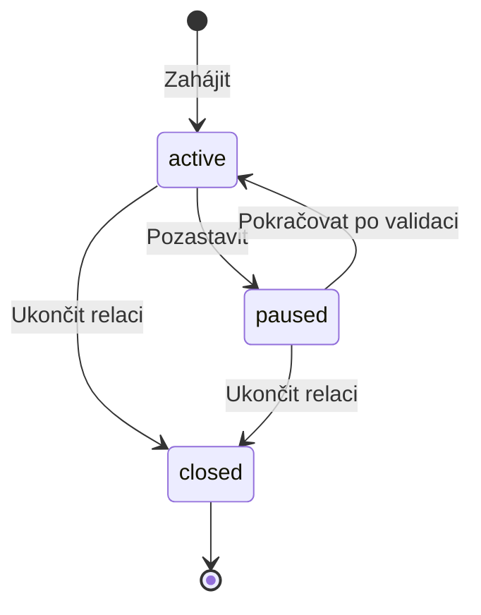

<!--
SPDX-FileCopyrightText: 2026 Antonín Mička
SPDX-License-Identifier: MPL-2.0
-->

# ADR 0088 — Pracovní kontext zahájeného úkolu ve Workspace

- Datum: 2026-11-21.
- Stav: **kontrakt s implementovanými řezy A/B/C/D a cíleným ověřením** pro
  `PLAN-TASK-WORK-01-A/B/C/D`. Zdroj obsahuje službu relací, pravý panel, evidenci činností a testy.
  Akceptace celé dávky a navazující LLM/recovery integrace
  zůstávají samostatné navazující části; tento stav je neprohlašuje za hotové.
- Autorita zadání: Workspace projekt `c898b941-8eb0-4406-8dad-6e2b96c06d59`,
  snapshot `c7b61487c2ef842c272fa45ce74216c0b9667dea`, exportní revize
  `3bff4cffeed97f1e5bcc9b5a1ec7f6ffcffeb25fa710a2a4f3cfa96e67d868e8`.
  Jde o provenance tohoto návrhu, nikoli druhý živý plán.
- Zdrojový základ: `54e66fe87f69b10c849ba1bf58fc7bb05f9dabc6` po merge #152.

## Účel a hranice

Uživatel zahájí konkrétní úkol z roadmapy nebo jeho detailu. Workspace vytvoří
pracovní relaci a naváže na ni následné činnosti. Zadání a dokončení úkolu
zůstávají autoritativně v projektovém Gitu; relace zaznamenává, v jakém kontextu
uživatel pracoval. Aktivní úkol se neodvozuje z otevřeného dokumentu, vybrané
položky roadmapy, pořadí fronty ani posledního projektu.

Kontrakt stanovuje model a lifecycle pro navazující implementaci. Pravý panel
řeší B, zachycení činností C, komentované záznamy D, LLM integraci E a společnou
persistenci/recovery F. Akceptační scénáře celé dávky drží Workspace. Implementace A/B/C/D není důkazem splnění celé dávky.

## Reuse a současný stav

| Součást | Použití v navržené implementaci |
| --- | --- |
| `Projects.plan_view`, `project_task_graph` | Validovaný aktuální graf, identita úkolu, checklist a jeho zdroj. |
| `dependency_start_blockers` | Jediné pravidlo zahajitelnosti z [ADR 0067](0067-plan-work-states-and-sum.md). |
| `PlanItems.open/save`, `item_span` | Připnutí vlastního bloku a scoped zápis beze změn ostatních uzlů. |
| `ide_bridge_panel._changes`, progress review | Existující chování zápisu Probíhá; před přímým UI zápisem vyčlenit sdílený kandidátní builder, nikoli vytvářet falešnou IDE relaci. |
| `Workspace.transact`, projektový journal | Zápis pracovního stavu a recovery podle [ADR 0003](0003-coordinated-operation.md). |
| `sqlite_ownership.store_connection`, `sqlite_connection` | Privátní lokální operační úložiště, readonly čtení a bounded contention. |
| `canLeaveWorkspaceEditors` | Ochrana neuloženého editoru při navigaci; samotné zahájení nic neukládá do rozepsaného dokumentu. |
| `ContextBuilder`, `TaskOutcomes`, chat/run journály | Budoucí zachycení kontextu před účinkem a vazba výsledku v C/E/F; původní run autorita se nekopíruje. |

[Fronta podle ADR 0087](0087-owner-task-queue.md) zůstává samostatným pracovním
výběrem. Změna pořadí ani odebrání odkazu z fronty neukončuje pracovní relaci.
Relace nedostává vlastní kopii roadmapy, registr dokončení ani alternativní
pravidla závislostí. Nový agent framework či povinný LLM provider nejsou potřeba.

## Identita a datový kontrakt

Pracovní relace `work_session_id` je neměnná identita jednoho pracovního úseku.
Není totožná s IDE session, chat threadem, run ID ani přihlašovací relací.
Základ záznamu:

| Pole | Význam |
| --- | --- |
| `schema_version` | Verze lokálního kontraktu; neznámá verze se odmítne bez přepsání dat. |
| `work_session_id` | UUID vytvořené před prvním účinkem; replay stejného zahájení použije stejné ID. |
| `project_id`, `task_id` | Skutečné project UUID a stabilní roadmapové task ID; existující ID se nepřejmenovávají. |
| `node_id`, `user_id` | Serverem ověřená identita uzlu a aktuálního uživatele, nikoli důvěryhodná pole klientského requestu. |
| `window_id` | Ověřené připoutání ke konkrétnímu pracovnímu oknu/tabu; součást vlastnictví lokálního kontextu. |
| `definition_pin` | Project commit, plan revision, source artifact/path a SHA-256 přesného vlastního bloku, ověřeného postupem `PlanItems.open`. |
| `definition_signature` | Digest obsahového zadání: ID/typ, rodič, název, popis, zdroj, závislosti a uspořádané texty checklistu; bez pracovních stavů a checked příznaků. |
| `state`, `revision` | Lokální `active`, `paused` nebo `closed` a monotonní CAS revize relace. |
| `created_at`, `updated_at`, `closed_reason` | Časové a kauzální údaje lifecycle; čas sám nerozhoduje o pořadí souběžných zápisů. |
| `previous_work_session_id` | Volitelná návaznost na předchozí úsek, například po přijetí nové verze zadání. |
| `selected_checklist` | `null`, nebo index bodu v checklistu svázaný s přesným `definition_pin`; nevymýšlí nová roadmapová ID. |

Lokální ukazatel aktivního kontextu má klíč `(node_id, user_id, window_id)`
a vlastní CAS revizi. Ukazuje nejvýše na jednu aktivní pracovní relaci, nebo
je prázdný. Historie relací se vyprázdněním ukazatele nemaže.

`definition_pin` se po zahájení nepřepisuje. Aktuálně ověřený HEAD patří do
oddělené projekce `validated_head`; nový nesouvisející projektový commit sám
neznehodnocuje shodné zadání. Změna obsahového zadání nebo jeho vazeb,
rozpoznaná přes `definition_signature`,
vyžaduje reconciliaci. Změna samotného pracovního stavu nebo zaškrtnutí bodu
checklistu se projeví v aktuální projekci, ale nevytváří nové zadání a nemění
původní pin. Přepočet podpisu stále používá úplnou validaci grafu; neignoruje
změny závislostí ani textů/pořadí checklistu. Přijetí změněného zadání uzavře
původní úsek s důvodem a založí
navazující relaci s novým pinem. Dřívější činnosti si ponechají původní pin.

Okno potřebuje vlastní serverem ověřené připoutání. Pouhé zkopírované UUID
v `localStorage` nebo duplikovaném `sessionStorage` není důkaz vlastnictví.
Nový tab dostane novou identitu; explicitní obnovení původní relace ověří
uživatele, uzel a její předchozí připoutání. Jiný uživatel ani vzdálený uzel
nemůže převzít aktivní ukazatel pouhým znalým session ID.

## Přechody a uživatelské akce

Kontrola přístupu a stavu zadání je samostatná projekce nad lifecycle.
`needs_reconcile`, `access_revoked`, `task_missing` a `source_unavailable`
nejsou nové stavy roadmapy. Po jejich zjištění nelze kontext použít pro novou
činnost; poslední lokální relace a dosavadní důkazy zůstávají zachované.

| Akce | Předpoklady a účinek |
| --- | --- |
| Zahájit | Platný aktuální graf, oprávnění zápisu, upravitelný projekt, nedokončený konkrétní task a splněná politika zahájení. Vytvoří relaci a aktivní ukazatel; při obsazeném okně vyžaduje explicitní Přepnout. |
| Pozastavit | Aktuální vlastněná relace a její CAS revize. Uvolní aktivní ukazatel; nemění projektový stav na Odloženo a neruší již spuštěný běh. |
| Pokračovat | Vlastněná pozastavená relace, znovu ověřené právo, pin a zahajitelnost. Obsazený ukazatel se nesmí přepsat implicitně. |
| Přepnout | Explicitní zdrojová relace/revize a nový cíl. Po úspěšném zahájení cíle pozastaví původní relaci a nastaví nový ukazatel jednou lokální transakcí. Při odmítnutí cíle zachová původní kontext. |
| Ukončit relaci | Uzavře lokální pracovní úsek a uvolní jeho ukazatel. Nezaškrtne task, checklist ani dávku. Další práce na stejném tasku dostane novou navazující relaci. |
| Navrhnout dokončení | Samostatný návrh s důkazy, připnutým cílem a verzí; sám neukončuje relaci ani nemění potvrzené dokončení. Lidské přijetí používá nativní projektový writer a znovu ověří podmínky dokončení. |

Zahájení přebírá přesně `dependency_start_blockers`: přímé předpoklady jsou
Vyřešeno/Dokončeno a nejvýše jeden může být Probíhá. Potvrzení dokončení
vyžaduje potvrzené checkboxy předpokladů, nikoli jen jejich zahajitelnost.
Zahajuje se konkrétní task; u skupiny UI nabídne volbu úkolu a nezruší SUM.
Task bez checklistu je plnohodnotný cíl. Volba bodu checklistu nic neodškrtává.

Zahájení zapisuje `status: in progress` stejným scoped/nativním postupem jako
existující progress přijetí. Pokud task už Probíhá, relace vznikne bez
zbytečného projektového commitu. Nevzniká druhý uložený pracovní stav tasku.
Intent nese předúčinkový `requested_pin`. Po potvrzení progress operace se
nová relace jednou finalizuje s `definition_pin` výsledného commitu; případný
no-op použije shodný commit. Tím vlastní zápis Probíhá nezpůsobí okamžitou
neplatnost nově zahájené relace. Oba piny a nativní receipt zůstanou propojené.
Pozastavení či uzavření jedné lokální relace tento sdílený stav nezmění:
na stejném tasku může současně pracovat jiné okno nebo jiný oprávněný uživatel.

Změna otevřeného projektu ani výběru v roadmapě kontext automaticky nepřepne.
Před činností v jiném projektu se nabídne pozastavení/přepnutí, nebo práce bez
vazby na aktivní úkol. Navigace zachovává dirty guard; zrušení dialogu nesmí
přepnout ukazatel ani uložit draft. Relace se nezahajuje obdržením synchronizace,
přijetím cizího záznamu, otevřením aplikace nebo obnovením run journalu.

## Logický request, replay a souběh

Mutace nese `operation_id`, aktuální `context_revision` a podle akce vlastní
session/revizi, cílové project/task ID, `expected_head` a digest definice.
Server odvozuje user/node/window binding z ověřené autority. Pole klienta
nemohou přepnout uživatele nebo převzít cizí okno. Implementační řez zpřístupňuje toto rozhraní na `POST /v1/task-work`;
konkrétní akce a omezení popisuje [návod](../task-work-context.md).

Stejné operation ID se shodným kanonickým requestem vrátí původní výsledek
nebo umožní dokončit původní záměr. Jiné bajty pod stejným ID jsou konflikt.
Dvojklik se stejným ID nevytvoří druhou relaci; dva různé souběžné požadavky
se stejnou CAS revizí nemohou oba přesměrovat jedno okno. Jiná okna mají různé
ukazatele. Chyba či ztracená odpověď vyžaduje načtení stavu původní operace,
nikoli nové operation ID a slepé zopakování.

Lokální metadata a nedokončené záměry patří do privátního node-local
operačního úložiště mimo projektový Git. Jde o autoritativní lokální stav,
nikoli obnovitelný projektový index. Implementace A používá databázi
`.<node-filename>.task-work/contexts.sqlite` s `user_version=1`, privátními
právy a stávajícími SQLite ownership helpery. Byla potřebná již pro bezpečný
start přes lokální intent a projektový writer. Její tabulky ukládají identitu
uzlu, vlastněná okna, relace a idempotentní operace; nekopírují text zadání,
task stav dokončení ani run journal. F má rozšířit společnou reconciliaci
o činnosti a potvrzené projektové záznamy, nikoli duplikovat tuto autoritu.
Projektové záznamy a komentované přílohy naproti tomu používají Git writer.

## Crash boundaries před implementací

Start/přepnutí zasahuje lokální záměr a případně projektový Git/index/journal.
Mezi nimi není distribuovaná transakce. Lokální intent váže původní ukazatel,
přesný request, nový session ID a deterministické project operation ID.
Rezervuje CAS revizi okna; do vyřešení nedovolí nové činnosti pod nejistým
kontextem. Starší již zachycené běhy přitom zůstávají přiřazené původní relaci.

| Hranice | Recovery a viditelný výsledek |
| --- | --- |
| Před lokálním intent commitem | Žádná změna projektu ani aktivního kontextu; starý kontext zůstává. |
| Intent uložen, projektová operace ještě nezačala | Stejné ID načte původní záměr. Znovu ověřit autoritu a pin; stale/odmítnutý start se uzavře bez přepnutí starého kontextu. |
| Projektová operace `prepared` až publikace | Obnovuje původní projektový journal podle ADR 0003; nesmí vzniknout nový projektový operation ID či druhý commit. Projektový index nerozhoduje o lokálním intentu. |
| Projektový commit/index dokončen, lokální finalizace chybí | Ověřit původní receipt, zapsat výsledek a přepnout ukazatel jednou lokální transakcí. Probíhá v projektu samo o sobě nedokládá dokončený start relace. |
| Lokální relace/ukazatel potvrzeny, odpověď ztracena | Stav původní operace vrátí stejnou relaci a výsledek; replay nezaloží další relaci ani commit. |
| Restart okna nebo backendu | Nejprve dohledat pending operace. Existující relaci nabídnout k explicitnímu pokračování; neaktivovat práci v jiném okně a nespouštět model ani síťový účinek. |

Pokud během recovery zanikne oprávnění či platnost připoutání, nesmí se
z původního requestu vyrobit nové oprávnění. Již publikovaný projektový commit
se tiše nevrací zpět; lokální operace má dohledatelný blokovaný/nejistý výsledek
a čeká na oprávněnou reconciliaci. Původní kontext se nezahodí a nepřesměruje
na jiný task. Čtení obsahu respektuje nynější práva.

Lokální pause/close a změna ukazatele bez projektového účinku jsou jedinou
lokální transakcí. Zámky lokálního intentu se nedrží přes projektový writer
nebo síťové/modelové volání; mezi fázemi je trvalá rezervace s CAS. Po skončení
projektové operace se finalizuje stejný intent. Tím nevzniká cyklus lokální
DB lock → projektový lock → lokální DB lock.

## Změna zadání, práv a kontext běhu

Před zahájením, pokračováním a novou činností se kontroluje nynější autorita,
read-only stav, existence tasku a obsahový podpis vůči pinu. Start request
navíc vyžaduje přesný aktuální HEAD a digest bloku před zápisem. Nesouvisející HEAD se rozliší od změny
zadání. Neplatný graf, nedokončená projektová operace a nedostupný zdroj mají
výslovný blokující stav. Po dokončení tasku jiným aktérem se nedovolí další
práce pod starým aktivním kontextem bez vědomého založení nového zadání.

Při odebrání práv se nezveřejní cachované zadání ani podklady. Zachová se
vlastní lokální rozpracovaný draft a dohledatelná existence pracovní relace;
žádné automatické uložení/export do nepovoleného projektu nebo odeslání LLM.
Restart/odhlášení nesmí takový draft tiše přenést jinému uživateli.

C/E před účinkem zachytí neměnnou vazbu `(work_session_id, definition_pin,
project_id, task_id, node_id, user_id)` spolu s operation/run ID. Změna aktivního
ukazatele už tuto vazbu nepřepíše. Pozdní výsledek patří původnímu tasku také po
pozastavení či uzavření relace; možnost jej číst nebo publikovat se posoudí
podle nynějších oprávnění. Neuložený text není uložený artefakt.

Zahájení samo nevolá LLM a nevytváří implicitní Context Manifest s veškerým
obsahem projektu. Nový uživatelem vyžádaný běh používá existující ContextBuilder,
RBAC/privacy a přesné vstupní revize. Local-only data zůstávají v lokální
hranici důvěry. Toto je integrační závazek pro E, nikoli nová implementace
LLM workflow v A.

## Předání a požadované důkazy

Kontrakt A lze posoudit podle jednoznačné identity, stavových přechodů,
rozdílu start/complete, dvou oken a dvou uživatelů, změněného zadání,
odebraných práv a uvedených hranic pádu. Autoritativní akceptace zůstává
ve Workspace; tento dokument neoznačuje úkol ani dávku za dokončené.

Implementační ověření navazujících částí musí zahrnout:

| Scénář | Požadovaný důkaz |
| --- | --- |
| Task bez checklistu, start s jedním Probíhá předpokladem | Relace vznikne; dokončení se tím nepovolí, nejsou-li předpoklady potvrzené. |
| Dvě Probíhá závislosti, read-only, cizí uživatel/okno | Start odmítnut bez změny relace, roadmapy nebo draftu. |
| Dvojklik, souběh a ztracená odpověď | Jedna relace a nanejvýš jeden progress commit; původní operace je dohledatelná. |
| Přepnutí A → B během běhu | Nová činnost patří B, původní výsledek stále A; společný task store nevznikne. |
| Nový nesouvisející HEAD nebo běžná změna stavu/checklistu proti změně definice | První zachová původní pin a aktualizuje projekci; změna textu/závislostí/pořadí bodů vyžádá reconciliaci. Vlastní progress commit start nezneplatní. |
| Odebrání práv, smazaný task, pending projektový writer | Viditelná blokace bez úniku obsahu, přesměrování a ztráty draftu. |
| Procesový pád na každé výše uvedené hranici | Replay původních ID, bez dvojího commitu/relace a bez samovolného modelového pokusu. |
| Pause/close, restart a synchronizovaný cizí záznam | Žádné automatické dokončení tasku ani převzetí aktivního kontextu. |

Tyto případy zde mají úroveň specifikace. Budoucí úspěšný happy-path, existence
panelu nebo test mock služby nenahradí crash/souběhové testy a oba živé
uživatelské scénáře celé dávky.

## Implementační řezy A/B/C/D

Zadání implementace bylo ověřeno nad snapshotem
`5e715a57728a0483fb784b090e03f7cbaeea47ef`, exportní revizí
`f51f66a23da1858c6d2804cff31a15187588145252182fca2e7a370e3bdddae1` a zdrojovým
HEAD `e4d7683` obsahujícím původní kontrakt. Jde o další provenance, ne změnu
historického základu návrhu výše.

- `spikes/task_work.py`: lokální store, CAS relací/okna, start/switch/resume,
  pause/close, lokální návrh dokončení, snapshot kontextu a recovery/cancel.
- `spikes/plan_progress.py`: sdílený čistý builder Probíhá, použitý i původním
  IDE progress writerem. Existující IDE pravidla pro checklist a SUM se nemění.
- `spikes/task_work_ui.py`: Zahájit úkol v detailu a trvalý pravý panel B
  se zadáním, postupem, výběrem checklistového kontextu a lifecycle ovladači.
  V úzkém okně používá přístupný dialog; editor a jeho draft jsou oddělené.
- `POST /v1/task-work`: ověřená identita uživatele, capability konkrétního okna
  a znovu ověřovaná projektová oprávnění; readonly status/inspect/capture mají
  vlastní HTTP read lane. Native project a lokální DB/flock zůstávají autority.

Každý rozpracovaný start drží neblokující flock podle operation ID, aby se
replay a cancel téhož intentu nemohly předběhnout. Pořadí je operation owner →
krátká lokální transakce nebo projektový writer; lokální DB se nedrží přes Git.
Přepnutí a následný lokální ukazatel se finalizují jednou transakcí. Přijetí
nové definice stejného tasku uzavře předchozí úsek s `definition-updated`.

Server ukládá pouze hash window capability. Explicitní obnovení po reloadu
ji rotuje pomocí původního důkazu a stabilního restore operation ID; staré okno
už nemůže kontext číst nebo měnit. Přesný replay ztracené restore odpovědi
vrátí stejnou novou capability, dokud okno nepřevezme další operace. Klient
uchovává pending restore request pro tento replay a nikdy se k předchozímu
oknu nepřipojuje automaticky. Aktivní relace se při převzetí pozastaví.

Testy A ověřují stavové přechody, task bez checklistu, dvě okna a uživatele,
HTTP role/revokaci, checklist bez změny definice, různé projekty se stejným ID,
immutable capture, přijetí změněné definice, stale/cancel/replay, neplatnou
verzi/unsafe store a ukončení procesu před/po native publikaci i finalizaci.
Qt průchod ověřuje také dirty editor, ztracenou odpověď, explicitní recovery,
reload a ovládání v úzké šířce. Cílené testy nejsou plná závěrečná brána dávky
ani lidská akceptace běžného profilu.

Návrh dokončení je v A lokální položka relace se stavem pending. Nepublikuje se
zatím jako komentovaný Git artefakt ani nabídka jinému reviewerovi a nepoužívá
se jako důkaz akceptace tasku. To patří do D/F. Evidence nativních souborových/chat/LLM činností je implementovaná v C;
komentované připojení výstupů je implementované v D a vstupní kontext modelu patří do E. Žádný LLM účinek není součástí startu.

Řez B navazuje na zdrojový HEAD `94ab3ac` při stejném ověřeném exportu výše.
Výběr checklistu je lokální CAS operace `select-checklist` nad existující DB
verze 1. Zachovává původní pin a nemění splnění ani projektový Git/index.
Commit a replay jediné SQLite transakce používají výše uvedené recovery;
nevzniká nová hranice mezi persistentními vrstvami. Capture zmrazí i vybraný bod.
Testy B ověřují přesný replay, stale/revokaci/změnu zadání, uzavřenou relaci,
nezměněný Git a původní capture. Qt průchod ověřuje trvalý panel u podkladu,
dirty editoru a chatu, bezpečné vykreslení, mobilní fokus/Tab/Escape,
zrušenou navigaci a vyčištění obsahu při ztrátě oprávnění. Řez C doplňuje evidenci činností; komentované přílohy patří do D.
Lokální návrhy dokončení jsou oddělené.

## Implementační řez C

Navazuje na zdrojový HEAD `0776ba5` při stejném ověřeném exportu výše.
`TaskActivities` adaptuje existující vlastněný TaskWork store a jeho tabulku
operací: `record_type=task-activity` odděluje záznamy od lifecycle intentů.
Event UUID má vlastní namespace a otisk nativního requestu; credential ani
request body se neukládají. Verze schématu 1 i umístění DB zůstávají stejné.
Nejde o projektový index ani nový plán. Publikované projektové záznamy doplňuje D.

Sdílený HTTP dispatcher zachytí ověřený kontext před nativní akcí; webový
import používá stejný wrapper se svými původními kontrolami autora/privacy.
Streamové adaptéry doplní výsledek před zápisem terminálního rámce na socket.
Task/run/writer ID a jejich vlastní journal se nemění. Reuse registr nativních
akcí se sdílí s UI; náhledy, drafty a klávesy se nezaznamenávají.

Crash boundaries rozšiřují tabulku výše o evidenci činnosti: před lokálním
intentem žádný účinek; po něm a před potvrzeným native receipt je stav unknown;
po nativním účinku bez finalizace zůstane unknown; explicitní replay původního
ID dohledá nativní výsledek; po finalizaci ztráta odpovědi nevytvoří druhý event.
Lokální DB transakce se nedrží přes nativní writer, index, síť ani provider.
Žádná obnova evidence automaticky neopakuje nativní či placenou operaci.

Reference obsahují pouze identifikátory a revize z nativních struktur, nikoli
modelový `outcome`, texty nebo credential. Projekce znovu ověřuje práva a web
nepublikuje desktopové záznamy ani reference do projektu s local-only daty.
Původní context pin se nemění při změně aktivního úkolu, uzavření relace ani
ztrátě oprávnění během běhu. Zápis receipt nevyžaduje znovu zpřístupnit obsah.

Cílené důkazy C zahrnují pád procesu před nativním účinkem a po skutečném
Git commitu před finalizací, přesný replay bez druhého commitu, stale/CAS,
cizí okno, změnu tasku za běhu, revokaci, oddělení web/desktop hranice a
nepovýšení modelového návrhu na důkaz uloženého artefaktu. HTTPS průchod
ověřuje skutečné save/import/delete, terminální NDJSON po přepnutí a chybu
finálního zápisu evidence: nativní úspěch zůstane úspěchem a evidence unknown,
dokud explicitní původní replay nedoplní receipt. Qt ověřuje, že dirty draft
nevytvoří event a uložený dokument se sám zobrazí v panelu. Test streamu používá
řízenou náhradu modelového volání; nedokládá placený ani živý Ollama běh.

## Implementační řez D

Zdrojový základ je `b95eb7a`. Při zahájení byl ověřen stejný export jako u C;
následná kontrola živého kanonického projektu má HEAD
`a1555ecfc6a78888e3f3af4590bbcb8a68692645`: B completed, C in progress,
D planned a startable. Export byl zadržen doručeným reportem C; tento stav
ani explicitní pokračování uživatele nejsou automatickým review reportu.
Oprava oddělení obnovy fronty a review je popsána v ADR 0062.

`TaskRecords` adaptuje TaskWork operations, operation flock a nativní
`Workspace.transact`. Nabídky jsou CAS lokální metadata eventů. Potvrzení
seskupených událostí rezervuje eventy a připraví neměnný intent bez credential.
Eventy mají shodný původní projekt/task/session/definition pin; jednotlivé
checklistové kontexty zůstávají v provenance. Komentář má vlastní volitelný
bod původního checklistu. Unknown/failed událost nedokládá souborový výsledek.

Projektový artefakt s běžnou sidecar obsahuje `task-work.json` a schéma
`fpw-task-record-v1`. `task_record_schema` je součástí validace snapshotu
a sémantického přechodu: jedno event ID patří nejvýše jednomu záznamu,
provenance a výsledkové piny jsou neměnné, opravy připojují revize a nepřepisují
historii. Není zde stav splnění úkolu. Privacy nesmí být nižší než původní
podklady, výsledky a evidence; staré události bez klasifikace jsou local-only.
Náhled původní verze kontroluje nynější oprávnění, historii commitu i SHA-256
přesných bajtů. Nynější verze může být odstraněná, aniž zmizí původní pin.

| Hranice zápisu D | Recovery |
| --- | --- |
| Před lokálním intent commitem | Projekt ani nabídka se nezmění; request lze znovu explicitně odeslat. |
| Po intentu před native writerem | Rezervace eventů brání dvojímu potvrzení; recover použije původní obsah, cancel pouze při absenci nativní operace. |
| Nativní prepared až index | Původní Workspace journal a stejný deterministický operation ID. |
| Po commitu/indexu před lokální finalizací | Recover dohledá původní receipt a potvrdí lokální nabídku bez druhého commitu. |
| Po lokální finalizaci, ztracená odpověď | Stejný request/ID vrací původní výsledek. |

Operation flock se drží přes konkrétní publish/recover/cancel, ale SQLite
transakce se nedrží přes projektový writer ani síť. Změna HEAD nepřebazuje
připravený záměr. Ztráta oprávnění blokuje čtení/publikaci, neodstraňuje draft
a nespouští jiný účinek. Události po přepnutí relace zůstávají u původního tasku.
Cílené důkazy zahrnují skutečné ukončení procesu před intent commitem, po
intentu, po projektovém commitu a před lokální finalizací; dále CAS, replay,
seskupení, immutable historii, exact/current/deleted náhled, privacy a HTTPS.
Qt průchod ověřuje rozepsaný komentář při refreshi, odložení, znovuotevření,
potvrzení, náhled a opravu při zachování neuloženého editoru.

Souborové výsledky D se odvozují z nativního journal receipt a Git diffu
příslušného commitu, nikoli výčtem vstupních artifact referencí. Tím se zachytí
i vícesouborový import a nativní publikace s `project_commit` místo `commit_id`.
Odstraněný artefakt se připne k verzi před odstraněním. C zachovává také
`project_commit` reference nativních výsledků; samostatný vstupní project pin
bez uloženého výsledku se za output nepovažuje.

## Oprava restartu desktopu a přímé dokončení — 21. 11. 2026

Uživatelské ověření po `66eec2c` odhalilo ztrátu dostupnosti pracovního kontextu
po restartu. Desktop používá unnamed/off-the-record Qt profil a náhodný port
lokálního API: sessionStorage ani origin nepřetrvají. Relace v TaskWork DB se
přitom neztrácely. Není důvod zavádět persistentní browser profil nebo kopii
plánu. Ověřený export má snapshot `b17262862d92d70af5cf01167f3127bcdc39f320`,
revizi `5a4fe648da95d54c128c5fc693c4bdabfd55475ca10142c329e2e402f35b35ad`.

Autentizovaný readonly `history` zpřístupní pouze vlastní uložené relace.
Obsah zadání a oprávnění se znovu posuzují; nejistý kontext je pouze redigovaný
odkaz, nikoli cachovaný text. Uživatelská akce Obnovit a pokračovat použije
`reclaim`: ověří čerstvou capability prázdného nového okna, vlastníka vybrané
relace a CAS obou oken/relace. Jedinou lokální transakcí pozastaví původní
aktivní kontext a rotuje capability původního okna. Zachová jeho ID i všechny
původní session/event/record reference. Teprve po výslovném potvrzení uživatele
se případně zavolá běžné resume. Jiný účet ani znalost session UUID nestačí.

Reclaim používá deterministickou novou capability odvozenou od čerstvého
ověřeného důkazu a operation ID; do DB patří pouze její hash, nikoli credential
v requestu. Replay ztracené odpovědi vrátí tentýž výsledek, pokud jej nenahradilo
novější převzetí. Pád před lokálním commitem nic nezmění, po commitu se dohledá
původní operace. Po úplné ztrátě browser stavu lze uloženou relaci znovu vypsat
pod ověřenou identitou. Nedokončené native účinky se automaticky neopakují.

`complete` je explicitní lidská mutace, oddělená od close i lokálního návrhu.
Adaptuje pure formatter existujícího IDE human review přes
`plan_progress.completion_changes`, bez vytváření IDE zprávy či falešné relace.
Ověří původní obsahový podpis, aktuální HEAD, oprávnění, leaf/SUM pravidla,
dokončené závislosti a již splněný checklist. Poté použije stávající TaskWork
intent → native Workspace/Git/index → lokální finalizaci. Po nativním receiptu
uzavře vybranou relaci s `task-completed`; pokud je aktivní jiný úkol, jeho
ukazatel zachová. Piny ani rozpracované editory se nemění.

Crash boundaries jsou stejné jako pro start: před intentem žádný účinek,
po něm původní reservation, po Git commitu před finalizací stejné operation ID
pro recover, po finalizaci přesný replay bez druhého commitu. Source Git zůstává
autoritou dokončení, lokální DB pouze relace. Test skutečně ukončeného procesu
ověřuje obnovu po commitu i zachování jiného aktivního úkolu. HTTPS ověřuje
vlastnictví, cizí účet a explicitní lidské potvrzení. Qt průchod používá nový
server origin a nový dočasný profil bez sessionStorage, zachová uložený bod,
činnosti/komentář a dokončí úkol při ponechání dirty editoru.

## Projekce záznamů do detailu roadmapy — 21. 11. 2026

Na přímé uživatelské zadání doplňuje detail úkolu sekci Plnění úkolu a výsledky.
`record-list` čte Git záznamy podle `(project_id, task_id, expected_head)` bez
pracovní capability. Stejný potvrzený záznam je proto dostupný i po ukončení
relace a jinému oprávněnému čtenáři projektu. Read-only role tím nezískává zápis.
API zvlášť vrací nejvýše 50 vlastních lokálních činností: jejich stav, komentář
a přesné nativní výstupy. Nedostupnost této SQLite evidence neblokuje Git záznamy
a není vydávána za prázdnou historii. Neprobíhá migrace, publikace ani nový zápis;
crash boundaries persistujících operací se nemění.

`record-preview` a `record-activity-preview` znovu kontrolují práva, task scope,
aktuální projektový HEAD, původní pin i nynější dostupnost cílového projektu.
První nevyžaduje vlastnictví relace autora; druhý je omezený na vlastní lokální
událost. Lokální či local-only evidence se nevydává cizímu účtu nebo webu.

Roadmapa adaptuje stejný DOM renderer potvrzeného záznamu jako pracovní panel
a stejný omezený náhled souborů. Opožděná odpověď po změně úkolu, projektu,
HEAD nebo zavření detailu se nevykreslí. Náhled nevytváří pracovní okno,
nepřebírá relaci, neukládá editor a neoznačuje úkol za splněný. Cílené testy
ověřují čtení bez capability a bez zápisového práva, oddělení lokálních událostí,
stale HEAD, jiný task, revokaci, výpadek lokálního store a Qt průchod roadmapou
včetně původní/aktuální verze a pozdní odpovědi po přepnutí detailu.

## Potvrzený záznam přímo v textu úkolu

Uložení výstupu vytváří pouze nabídku činnosti. Na následný výslovný požadavek
uživatele se obnovuje povinné **Potvrdit a připojit**; při čtení stavu ani při
uložení výstupu se záznam sám nepublikuje. Dříve uložené záznamy se nemažou.

Potvrzení ukládá ve stejné nativní transakci Workspace jak `task-work.json`,
tak stručný komentář a odkazy do vlastního Markdown bloku původního úkolu.
Oprava komentáře aktualizuje stejný řádek podle stabilního record ID; původní
revize zůstávají v Git historii a v záznamu. Obsah výstupních dokumentů se
nekopíruje. Komentář a názvy výsledků s vyšší privacy než zdrojový plán se
nepropagují; místo nich se použije obecný popis a pouze přípustné místní odkazy.

Reuse zůstává na writeru a crash boundaries řezu D: před commitem intentu
nevznikne žádný projektový zápis; po něm rezervace drží stejný record ID.
Změna task textu, sidecar a JSON patří do téhož Git commitu a journal recovery.
Po commitu a před lokální finalizací se obnoví původní receipt bez druhého
řádku či commitu. Stale HEAD se nepřebazuje a původní ukládání se neopakuje.

Pracovní signature ignoruje pouze přesný text projekce odpovídající skutečnému
validovanému záznamu daného úkolu. Samotný HTML marker tak zadání neskrývá.
Původní definition pin a checklist zůstávají zachované; změny ostatního textu
nadále vyžadují reconciliaci. Úprava evidence nepotvrzuje dokončení úkolu.

## Připojení existujícího artefaktu

Pracovní panel nabízí existující soubory/artefakty aktuálního projektu přes
`record-attachment-options`. Výběr není zápis. `record-attach` po explicitním
**Potvrdit a připojit** znovu ověří vlastníka okna/relace, zápisové oprávnění,
projektový HEAD, existenci souboru a minimální privacy. Identitu výsledku,
cestu, commit i SHA-256 odvozuje server z validovaného snapshotu; klient neposílá
filesystem cestu ani obsah. Nepřipojují se interní `task-work.json` záznamy.

Reuse/adaptuje se existující publish intent, `TaskRecords.run`, projekce do
textu úkolu i náhled původní/aktuální verze. Událost `artifact-attach` pravdivě
zachycuje připojení existujícího výsledku, nikoli jeho nové vytvoření nebo
uložení. Nemění původní soubor ani nabídku dřívější činnosti a nedokončuje task.
Připnutý výsledek si zachová původní verzi i po pozdější editaci souboru.

Hranice pádu jsou shodné s potvrzeným D: před intent commitem žádný projektový
účinek; po něm stejná neměnná příloha a deterministický event/record ID.
Text úkolu a záznam vznikají jednou Workspace transakcí. Po Git commitu před
lokální finalizací recover dohledá receipt bez druhé přílohy či řádku. Stale
HEAD se nepřebazuje; obnovení výběru zachová komentář a načte aktuální seznam.
Soubor pouze na disku mimo projekt se nejprve přidá stávajícím importem.

## Odkazy mezi projekty a kontext náhledu

Příloha úkolu může být připnutý odkaz do jiného projektu podle ADR 0070/0086.
Panel nabízí **Připojit odkaz z jiného projektu** přes existující sdílecí
workflow. První potvrzení vytvoří místní deskriptor sdíleného podkladu, vrátí
uživatele do výběru přílohy a druhé **Potvrdit a připojit** uloží záznam do úkolu.
Jde o dvě samostatně potvrzené transakce s vlastní recovery; zrušení druhého
kroku neodstraňuje již schválenou projektovou referenci. Zdroj se nemění.

Výběr, publish/recover i původní/aktuální náhled používají `CrossReferences`
s requestovým uživatelem a omezením na nyní čitelné/zapisovatelné projekty.
Resolver ověřuje živé sdílení, zdrojové granty, přesný pin a efektivní privacy.
Nedostupný či odvolaný odkaz se nenabízí jako použitelný. Náhled nikdy nepadá
zpět na cizí bajty z neověřené cache. Záznam připíná místní descriptor, takže
po explicitním repinu projektové reference původní záznam dál používá původní
zdrojovou revizi; aktuální náhled používá aktuální descriptor.

Relativní odkazy v obsahu se vyhodnocují vůči skutečnému zdrojovému projektu,
nikoli právě otevřenému projektu úkolu. Navigace zachová původní pracovní
kontext a respektuje guard neuložených editorů. Sdílený hlavní náhled, panel
úkolu i roadmapa předávají rendereru zdrojové project ID. Přenosnou identitu
cizího podkladu nadále nese reference, nevzniká konkurenční URI schéma.

Markdown náhledy rozpoznávají i HTTP(S) odkazy, escapované názvy a místní
cesty s mezerami. HTML zůstává inertní a javascript/data/file schémata nejsou
aktivní odkazy. Qt předá HTTP(S) odkaz systémovému prohlížeči pouze při uživatelské
události `newWindowRequested`; nepovoluje obecnou navigaci uvnitř shellu ani
nepřenáší lokální Authorization hlavičku do externího prohlížeče.
